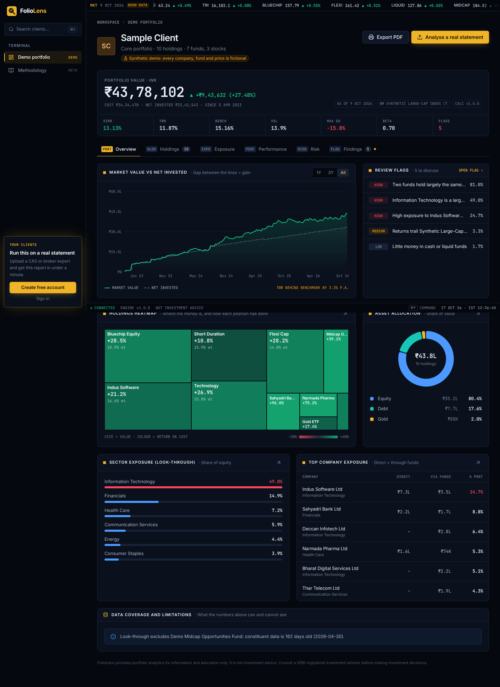
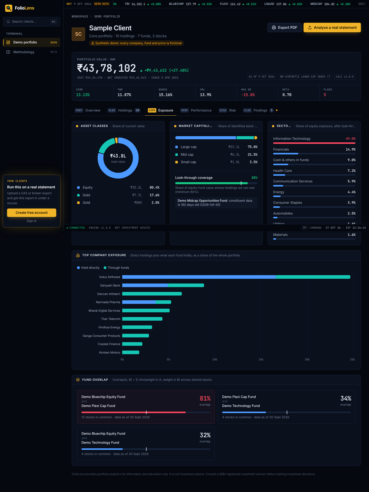
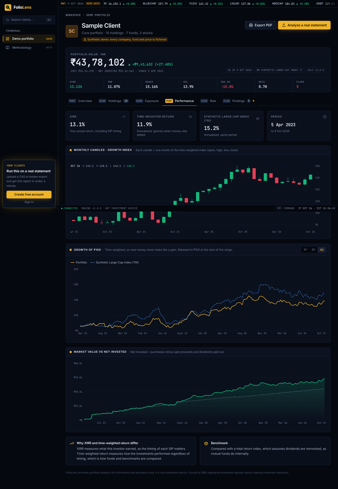
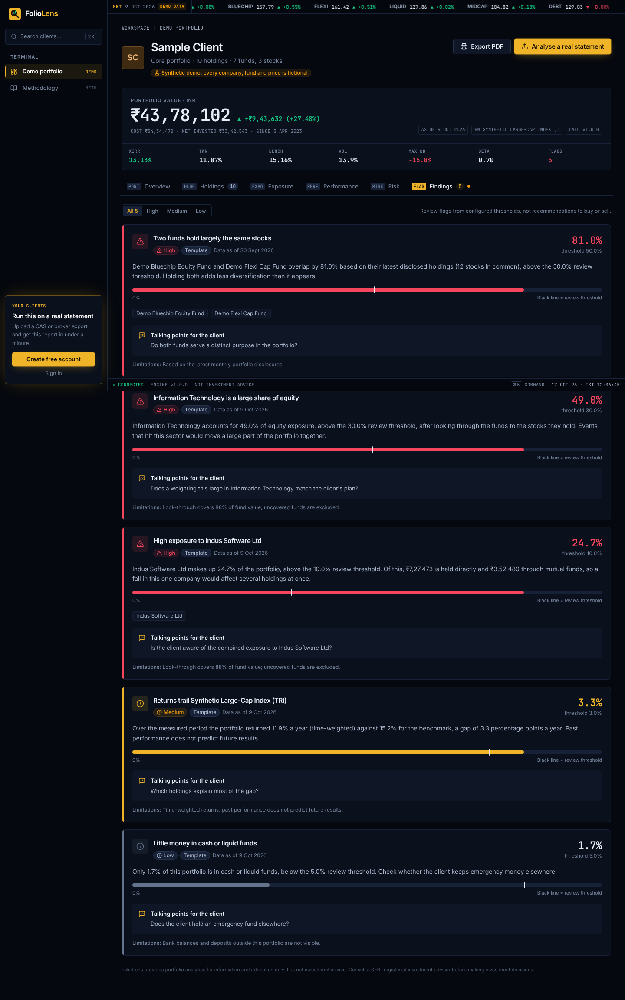
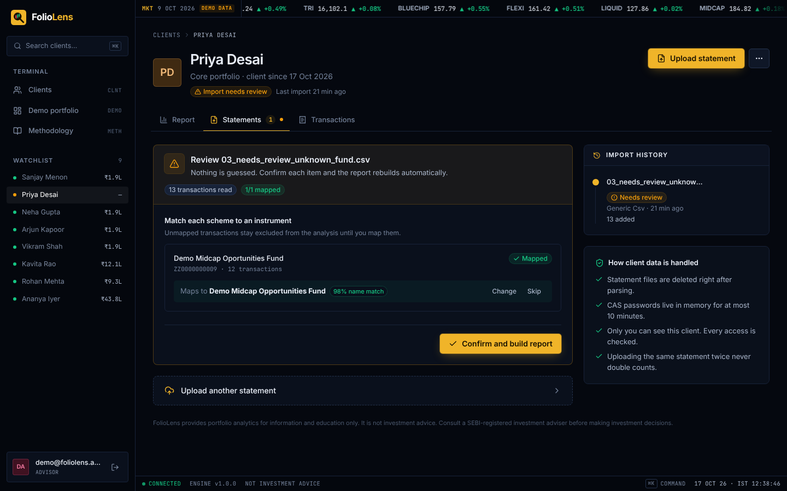
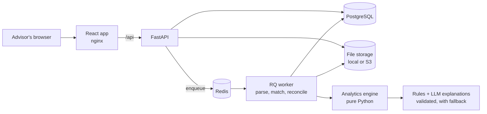

# FolioLens

**A wealth management platform for Indian financial advisors.** Upload a client's CAMS/KFintech CAS or broker
export. FolioLens rebuilds holdings from the transaction ledger, measures real returns (XIRR), looks
through every mutual fund to the stocks it holds, finds fund overlap and concentration, measures
historical risk, and explains what needs a conversation. Every number comes with its evidence.

> **Build principle:** verified financial calculations first, transparent evidence second, AI
> explanations third.



## What it does

| Area | Details |
| --- | --- |
| Statement import | CAMS/KFintech detailed CAS (PDF, password-protected), Zerodha Console tradebook (CSV), generic CSV template |
| Data quality | Instrument matching by ISIN; name suggestions need confirmation; CAS closing-unit reconciliation; nothing is silently dropped or guessed |
| Returns | Portfolio and per-holding XIRR (verified against Excel), time-weighted return, benchmark comparison |
| Exposure | Asset allocation, look-through to underlying companies, sector and market-cap exposure, fund overlap, HHI concentration |
| Risk | Annualised volatility, maximum drawdown, beta, 1-day 95% VaR (historical, with parametric cross-check), shown only with enough history |
| Findings | Rule-based review flags with measured value, threshold, data date and limitations |
| Why and what next | What helped and what held returns back (profit per holding, like-for-like index comparison), options to discuss for every flag with the money involved and an estimated capital-gains tax (FIFO, FY 2026-27 rules) |
| Risk profile and goals | Six-question risk profile with a suitability check and tax-aware rebalancing; goal planning with inflation, projections, funded ratio and the SIP needed |
| Client report | A printable plain-language report with the client's goals and the options the advisor ticks, plus an editable email draft |
| AI | Plain-English summary and explanations; every number the model writes is checked against the evidence, with a template fallback |
| Security | JWT auth, login rate limiting, per-user data isolation (tested), consent capture, audit log, raw files deleted after parsing |

Try the synthetic demo without signing in: `/demo`.

| Allocation and look-through | Performance |
| --- | --- |
|  |  |
| **Evidence-backed findings** | **Import review** |
|  |  |

## Architecture



- **Modular monolith:** one backend with clear domains (`identity`, `portfolio`, `market_data`,
  `analytics`, `insights`, `reports`, `audit`, `storage`, `jobs`).
- **The analytics engine is pure:** it never touches the database, API or LLM. The API, the worker
  and the demo all call the same `build_report()`, so identical inputs always give identical numbers.
- **Transactions are the source of truth.** Holdings are always derived from the ledger.

More detail: [docs/ARCHITECTURE.md](docs/ARCHITECTURE.md) · decisions: [docs/DECISIONS.md](docs/DECISIONS.md)

## Hard problems solved

1. **Correct XIRR for real SIP histories.** Irregular dates, partial sales, dividends and switches.
   The solver scans for sign changes, solves each bracket with Brent's method, polishes with Newton,
   and *refuses* to answer when cash flows have more than one valid rate instead of guessing.
2. **Contributions are not returns.** Daily returns use `(V_t − F_t) / V_{t−1} − 1`, so a new SIP
   instalment never looks like a gain. Drawdown uses the time-weighted wealth index for the same reason.
3. **Look-through without double counting**, using dated constituents. Funds with stale data
   (> 3 months) are excluded and disclosed, and sector views are flagged when coverage falls below 80%.
4. **Reconciliation.** Units rebuilt from CAS transactions must equal the statement's closing balance,
   or the import goes to review with the variance shown.
5. **Idempotent background jobs.** Each ledger row has a deterministic `source_ref`, so retries and
   re-uploads never double count.
6. **An LLM that cannot invent numbers.** Outputs are parsed, every number is matched to the finding's
   evidence, trade instructions are rejected, and the product works fully with the LLM switched off.

## Quick start (one command, macOS)

```bash
./start.sh
```

It starts Docker Desktop if needed, creates `.env` with a random secret, builds and starts every
container, loads the synthetic demo data, creates a ready-made login with an analysed client
portfolio, checks the AI settings and opens the browser.

- Demo (no login): http://localhost:8080/demo
- Sign in: `demo@foliolens.app` / `foliolens-demo-2026` (local demo account only)
- Stop: `./start.sh stop`

Manual equivalent:

```bash
cp .env.example .env            # then set JWT_SECRET
docker compose up --build -d --wait
docker compose exec api python -m app.market_data.cli seed-demo
docker compose exec api python -m app.market_data.cli seed-demo-account
docker compose exec api python -m app.insights.check_llm
```

AI explanations are optional: set `LLM_PROVIDER` (`openai`, `azure_openai` or `anthropic`),
`LLM_API_KEY`, `LLM_MODEL` and, for Azure, `LLM_ENDPOINT` in `.env`.

## Local development

```bash
# Backend (needs PostgreSQL and Redis running locally)
cd backend
python3.12 -m venv .venv && source .venv/bin/activate
pip install -e ".[dev]"
alembic upgrade head
python -m app.market_data.cli seed-demo
RUN_JOBS_INLINE=true uvicorn app.main:app --reload       # API docs at http://localhost:8000/docs

# Frontend
cd frontend && npm install && npm run dev                 # http://localhost:5173
```

## Tests and quality

```bash
cd backend
pytest --cov=app        # 75 tests: unit, reference, integration and security
ruff check app tests && mypy app
```

- XIRR is checked against Microsoft's published Excel example (37.336%) and an independent solver.
- Integration tests run the full upload → report flow and require the database result to match
  the pure engine within ₹1.
- Security tests prove one user cannot read, list or delete another user's portfolio.
- CI (GitHub Actions) runs lint, types, migration checks, tests (coverage ≥ 80%) and the frontend build.

## Real market data

See [docs/DATA_SOURCES.md](docs/DATA_SOURCES.md) for loading AMFI NAVs, NSE bhavcopy prices,
the Nifty 50 TRI benchmark, fund constituents and sector classifications.

## Deployment

[docs/DEPLOY_AWS.md](docs/DEPLOY_AWS.md): EC2 + Docker Compose, RDS PostgreSQL in a private subnet,
private encrypted S3 with lifecycle deletion, IAM role, SSM Parameter Store and CloudWatch.

## Known limitations

- One CAS family (CAMS/KFintech detailed CAS) and one broker format; NSDL/CDSL CAS not yet supported.
- Fund constituents must be prepared from AMC disclosures (formats vary by fund house).
- Stock splits and bonus issues are not yet adjusted automatically.
- Login rate limiting is per API process; use Redis-backed limits when running several instances.

---

FolioLens provides portfolio analytics for information and education only. It is not investment
advice and does not recommend buying or selling any security. Consult a SEBI-registered investment
adviser before making investment decisions.
