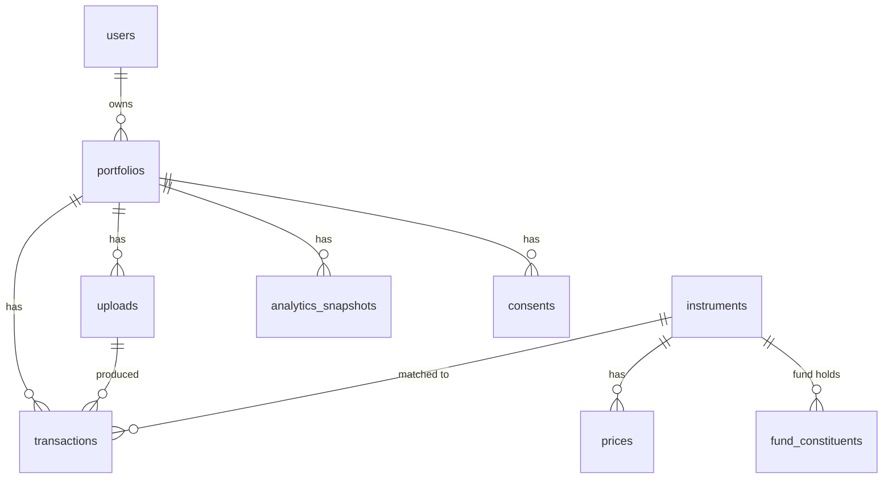

# Architecture

## Request flow: uploading a statement

1. The browser posts the file, the statement type, the consent checkbox and (for a CAS) the PDF password
   to `POST /api/v1/portfolios/{id}/uploads`.
2. The API checks ownership, consent, size (≤ 10 MB) and that the content matches the declared type
   (PDF magic bytes). It stores the file privately, records the consent and an audit entry, and
   enqueues a job. It returns `202 Accepted` immediately.
3. The CAS password goes into Redis under a key that expires in 10 minutes. It is never written to the
   database or the job arguments; the worker reads it once and deletes it.
4. The RQ worker parses the file into a neutral `ParsedStatement`, matches identifiers to the instrument
   master, inserts ledger rows (duplicates skipped by a unique `source_ref`), and runs reconciliation.
5. Status becomes `completed` or `needs_review`. The raw file is deleted.
6. On `completed`, the worker builds the report and saves an immutable `AnalyticsSnapshot`.
7. The browser polls the upload status and then loads the report.

## Modules

| Module | Responsibility |
| --- | --- |
| `identity` | Users, password hashing (bcrypt), JWT, login rate limiting |
| `portfolio` | Client portfolios, uploads, ledger, parsers, matching, ingestion, review API |
| `market_data` | Prices, NAVs, constituents; loaders and CLI for AMFI, NSE, index and CSV data |
| `analytics` | Pure financial functions: XIRR, holdings, value series, risk, exposure |
| `insights` | Rules engine, explanation templates, LLM adapter, output validation |
| `reports` | Report engine (pure) and service (loads DB data, saves snapshots) |
| `audit` | Audit log and consent records |
| `storage` | Local folder or S3, behind one interface |
| `jobs` | Redis queue, background jobs, failed-upload cleanup |
| `demo` | Deterministic synthetic portfolio and the public demo endpoint |

## Data model

- `transactions` is an append-only ledger with a unique `(portfolio_id, source_ref)`.
- There is no `holdings` table: holdings are derived on demand, so they can never disagree with the ledger.
- `analytics_snapshots` stores the full report JSON with its `calc_version` and valuation date.

## Why a pure engine

`reports/engine.py::build_report(PortfolioInput)` takes plain dataclasses and returns a dict. It has no
I/O. This makes every formula unit-testable, lets the demo run without a database, and lets an
integration test assert that the database path gives the same answer as the engine (within ₹1).

## Security controls

| Control | Where |
| --- | --- |
| Ownership checks on every private route, returning 404 (not 403) to avoid id probing | `portfolio/router.py` |
| Cross-user access tests | `tests/integration/test_auth_and_access.py` |
| Password hashing (bcrypt), JWT with expiry, ≥ 32-char secret, refuses default in production | `identity/`, `config.py` |
| Login rate limit: 5 failures per 5 minutes per email + IP | `identity/security.py` |
| Upload validation: size, type, magic bytes, consent | `portfolio/router.py` |
| Raw file deletion after parsing; failed uploads after 24 h | `portfolio/ingest.py`, `jobs/cleanup.py` |
| No PII in LLM requests; uploaded text is treated as data | `insights/llm.py` |
| Security headers and CSP | `frontend/nginx.conf` |
| Audit log of logins, uploads, reviews, deletions (no financial contents) | `audit/` |
