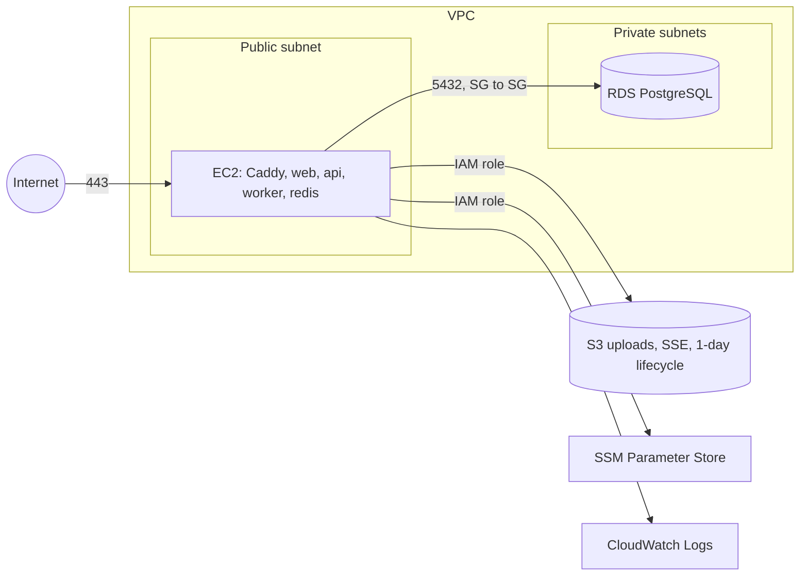

# Deploying FolioLens to AWS

Target shape (decision D-08): one EC2 instance running Docker Compose, RDS PostgreSQL in private
subnets, a private encrypted S3 bucket, secrets in SSM Parameter Store, logs in CloudWatch, and HTTPS
through Caddy with a free Let's Encrypt certificate. Region used below: `ap-south-1` (Mumbai).



> **Cost:** check current pricing and free-tier eligibility for your account before creating anything.
> Create the budget alarm in step 0 first. Stop or delete resources you are not using.

## 0. Account safety (do this first)

1. Enable MFA on the root user; stop using root.
2. Create an IAM admin user (or IAM Identity Center user) with MFA and use that.
3. **Billing → Budgets → Create budget**: a monthly cost budget with email alerts at 50%, 80% and 100%.

## 1. Network

Use the default VPC or create one with 2 public and 2 private subnets across two availability zones.

Security groups:

| Name | Inbound | Purpose |
| --- | --- | --- |
| `foliolens-ec2` | 80, 443 from `0.0.0.0/0`; 22 only from your IP (or none, and use SSM Session Manager) | The app server |
| `foliolens-rds` | 5432 **from the `foliolens-ec2` security group only** | The database is never public |

## 2. S3 bucket for uploads

```bash
aws s3api create-bucket --bucket foliolens-uploads-<yourname> --region ap-south-1 \
  --create-bucket-configuration LocationConstraint=ap-south-1
aws s3api put-public-access-block --bucket foliolens-uploads-<yourname> \
  --public-access-block-configuration BlockPublicAcls=true,IgnorePublicAcls=true,BlockPublicPolicy=true,RestrictPublicBuckets=true
aws s3api put-bucket-encryption --bucket foliolens-uploads-<yourname> \
  --server-side-encryption-configuration '{"Rules":[{"ApplyServerSideEncryptionByDefault":{"SSEAlgorithm":"AES256"}}]}'
aws s3api put-bucket-lifecycle-configuration --bucket foliolens-uploads-<yourname> \
  --lifecycle-configuration file://deploy/s3-lifecycle.json
```

The app deletes each file right after parsing; the lifecycle rule is a safety net that removes anything
left behind after one day.

## 3. RDS PostgreSQL

Console → RDS → Create database: PostgreSQL 16, the smallest burstable instance class, 20 GB gp3,
**Public access: No**, subnet group = private subnets, security group `foliolens-rds`, storage
encryption on, automated backups 7 days. Note the endpoint, database name `foliolens`, user and password.

## 4. Secrets in SSM Parameter Store

Store each value as a `SecureString` under `/foliolens/prod/`:

| Parameter | Example |
| --- | --- |
| `JWT_SECRET` | output of `python3 -c "import secrets; print(secrets.token_urlsafe(48))"` |
| `DATABASE_URL` | `postgresql+psycopg://foliolens:<password>@<rds-endpoint>:5432/foliolens?sslmode=require` |
| `S3_BUCKET` | `foliolens-uploads-<yourname>` |
| `DOMAIN` | `foliolens.example.com` |
| `LLM_PROVIDER` | `none`, `anthropic` or `openai` |
| `LLM_API_KEY` | your key (use a placeholder like `unset` if not using an LLM) |
| `LLM_MODEL` | the model ID from your provider's docs (or `unset`) |

```bash
aws ssm put-parameter --region ap-south-1 --type SecureString \
  --name /foliolens/prod/JWT_SECRET --value '<value>'
```

## 5. IAM role for the instance

Create a policy from `deploy/iam-policy.json` (replace the bucket name and account id), attach it to a
new role for EC2 named `foliolens-ec2-role`, and also attach `AmazonSSMManagedInstanceCore` so you can
connect with Session Manager instead of SSH. The app gets S3 and SSM access through this role:
**no access keys are stored on the server.**

## 6. EC2 instance

Launch Amazon Linux 2023, a small instance (at least 2 GB RAM for Docker builds), security group
`foliolens-ec2`, IAM role `foliolens-ec2-role`, public subnet, and paste `deploy/ec2-user-data.sh` as
user data. Allocate an Elastic IP and attach it so the address does not change.

## 7. Domain

Point an `A` record for your domain (Route 53 or any registrar) at the Elastic IP. Caddy requests the
HTTPS certificate automatically on first start.

## 8. Deploy

```bash
# On the instance (Session Manager or SSH)
cd /opt/foliolens
git clone https://github.com/<you>/foliolens.git .
./deploy/fetch-env.sh
export DOMAIN=foliolens.example.com
docker compose -f deploy/docker-compose.prod.yml up -d --build
docker compose -f deploy/docker-compose.prod.yml run --rm api python -m app.market_data.cli seed-demo
```

Open `https://<your domain>/demo`.

## 9. Scheduled jobs

```bash
crontab -e
# Delete raw files of failed uploads older than 24 hours, every hour
0 * * * * cd /opt/foliolens && docker compose -f deploy/docker-compose.prod.yml run --rm api python -m app.jobs.cleanup
# Refresh mutual fund NAVs every weekday evening (IST, server clock in UTC)
30 16 * * 1-5 cd /opt/foliolens && docker compose -f deploy/docker-compose.prod.yml run --rm api python -m app.market_data.cli fetch-amfi
```

## 10. Monitoring

- Container logs go to CloudWatch Logs group `/foliolens/app`.
- Create a CloudWatch alarm on EC2 `StatusCheckFailed` and on RDS `FreeStorageSpace`.
- Add a simple uptime check on `https://<domain>/api/v1/health`.

## Updating

```bash
cd /opt/foliolens && git pull && docker compose -f deploy/docker-compose.prod.yml up -d --build
```

Migrations run automatically when the API container starts.
